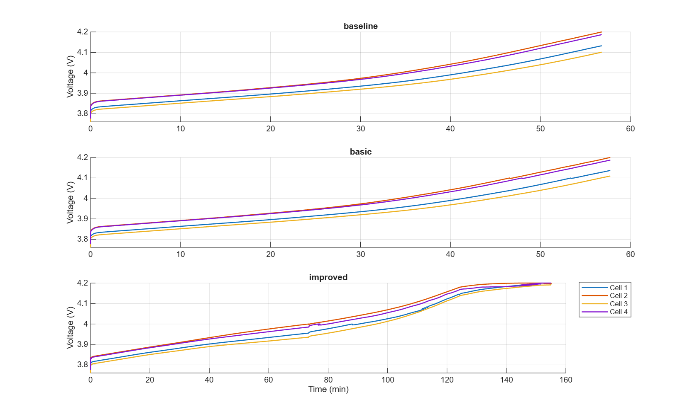
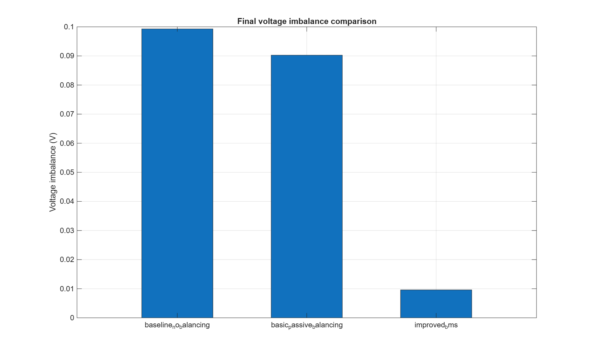
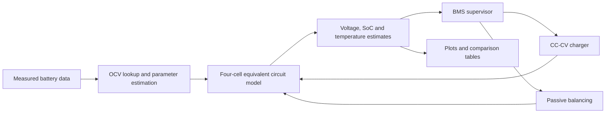

# Design of a Battery Management System (BMS) for UAV Multicell Battery Charging

**MATLAB / Simulink study of charging control and passive balancing for a 4S LiPo UAV battery pack.**

This diploma project compares three charging strategies for four mismatched cells: no balancing, basic passive balancing, and an improved BMS with earlier balancing and adaptive current reduction. It includes MATLAB simulation code, a Simulink model builder, recorded results, and a discussion of the charging scenarios.



> **Repository status:** recovered research source and archived results. The original NASA/Oxford data and generated Simulink models are not bundled. The full MATLAB pipeline has not been rerun after recovery.

## What the project demonstrates

- A first-order equivalent circuit model for a four-cell series pack with capacity, resistance, and initial state-of-charge mismatch.
- Constant-current / constant-voltage charging with passive balancing.
- State-of-charge estimation, simplified thermal behavior, and supervisory protection logic.
- Comparison of charging duration, final voltage imbalance, SoC spread, and termination conditions.

## Recorded results

The following values come from the archived [scenario comparison CSV](results/scenario_comparison_summary.csv), rounded for readability. They are simulation results from the original study, not a new run or a hardware performance claim.

| Strategy | Charging time | Final voltage spread | Final SoC spread | Termination |
| --- | ---: | ---: | ---: | --- |
| No balancing | 3,408 s | 99.29 mV | 7.138 percentage points | Predicted overvoltage |
| Basic passive balancing | 3,465 s | 90.26 mV | 6.684 percentage points | Predicted overvoltage |
| Improved BMS | 9,304 s | 9.60 mV | 0.838 percentage points | Current cutoff |

In this scenario, the improved controller reduced final voltage spread by approximately **90.3%** relative to no balancing, with a substantially longer charging time. This is a tradeoff between cell equalization and charging speed.



The archived [single-cell validation](results/model_validation_metrics.csv) used 250 points from an Oxford current profile: voltage RMSE **0.1214 V**, MAE **0.0779 V**, and R² **0.0487**. The low R² limits claims about predictive accuracy; this is an exploratory model, not a validated battery digital twin.

## Architecture



The MATLAB scenario runner contains the main research simulation. The Simulink builder represents the supervisory architecture with simplified internal models; the two implementations should not be treated as interchangeable validated models.

## Repository layout

| Folder | Contents |
| --- | --- |
| [`config/`](config/) | Initialization for the standalone MATLAB example |
| [`functions/`](functions/) | Cell models, importers, control logic, plotting and reporting |
| [`scripts/`](scripts/) | Executable `step00`–`step13` pipeline and standalone runners |
| [`simulink/`](simulink/) | Model builder and build guide |
| [`results/`](results/) | Archived figures and CSV tables |
| [`reports/`](reports/) | Simulation results and research discussion |
| [`docs/`](docs/) | Dataset setup and reproducibility notes |

## Run the MATLAB code

Open MATLAB with this repository as the current folder. The code was developed with modern MATLAB APIs; the minimum supported release has not been established. Simulink is required only for the Simulink workflow.

### Standalone example

This earlier, self-contained model uses configured parameters and does not import the external datasets:

```matlab
run(fullfile('scripts', 'run_bms_simulation.m'))
```

It is a separate demonstration, not a reproduction of the three-scenario table above. Runners write into `results/` and may replace archived outputs; use a separate working copy if you want to retain an unchanged reference.

### Full research pipeline

Place the original datasets according to [dataset setup](docs/DATASETS.md), then run:

```matlab
run(fullfile('scripts', 'run_full_diploma_project.m'))
```

The pipeline imports data, constructs the OCV lookup, estimates parameters, runs all three scenarios, and generates reports and validation metrics. Without the original inputs, the archived numbers cannot be reproduced faithfully.

### Simulink architecture

```matlab
run(fullfile('scripts', 'step00_project_setup.m'))
modelName = build_bms_simulink_model();
```

See the [Simulink build guide](simulink/Simulink_Build_Guide.md) for the current simplifications and manual adjustments.

## Results discussion

See the [simulation results and discussion](reports/chapter3_results_and_discussion.md) for the charging scenarios, model assumptions, interpretation and limitations.

## Scope and reproducibility

The cell and thermal models are simplified. The archived results describe a simulation study and do not establish hardware performance. Dataset availability, recovery status and current verification are documented in [REPRODUCIBILITY.md](docs/REPRODUCIBILITY.md).

External datasets are not redistributed; see [dataset setup and attribution](docs/DATASETS.md). No open-source license has been selected for this repository.

## Кратко по-русски

Дипломный проект о системе управления зарядом четырёхэлементного LiPo-аккумулятора БПЛА. В репозитории собраны MATLAB-код, генератор модели Simulink, графики, таблицы результатов и анализ сценариев зарядки. Исходные датасеты отсутствуют; сохранённые результаты пока не перепроверены повторным запуском.
